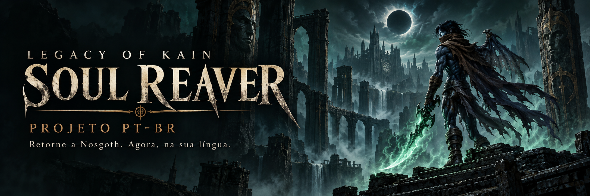
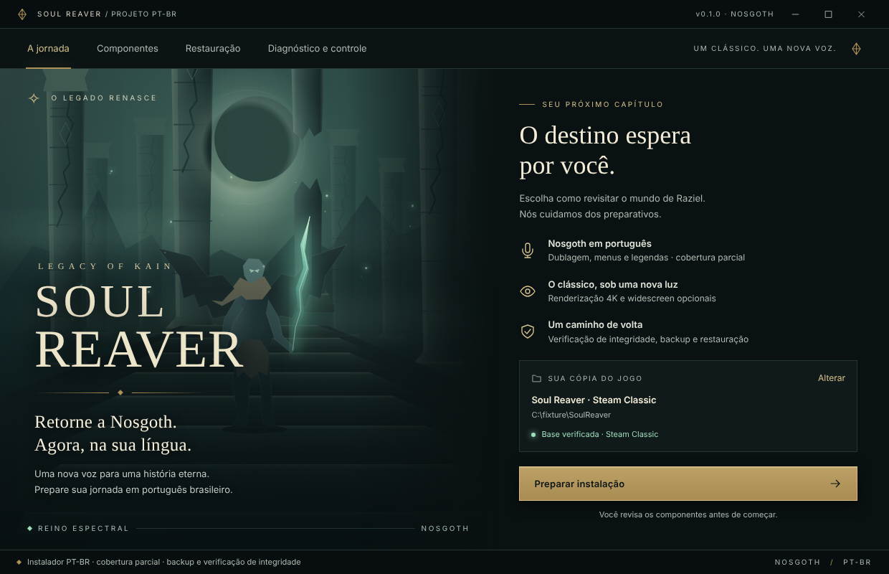
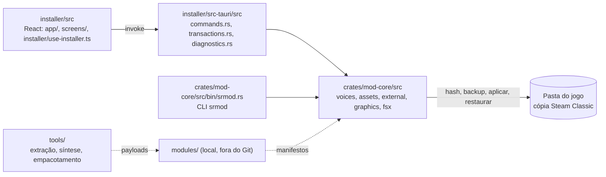

<p align="center">
  
</p>

<h1 align="center">Soul Reaver · PT-BR</h1>

<p align="center">
  <strong>Retorne a Nosgoth. Agora, na sua língua.</strong><br />
  Dublagem brasileira, tradução e melhorias visuais para Legacy of Kain: Soul Reaver clássico de PC.
</p>

<p align="center">
  <sub>WINDOWS &nbsp; · &nbsp; STEAM CLASSIC &nbsp; · &nbsp; PORTUGUÊS BRASILEIRO</sub>
</p>

<p align="center">
  <a href="#recursos">Recursos</a> &nbsp; / &nbsp;
  <a href="#instalador">Instalador</a> &nbsp; / &nbsp;
  <a href="#como-usar">Como usar</a> &nbsp; / &nbsp;
  <a href="#documentação">Documentação</a>
</p>

> [!WARNING]
> **Em desenvolvimento · campanha parcial · ainda não homologado.**
> O instalador e os pipelines têm validações offline. Cobertura, qualidade das vozes,
> sincronismo e funcionamento nas cenas do jogo continuam em avaliação.

## Recursos

O projeto reúne localização em **pt-BR**, vozes distintas por personagem e melhorias
opcionais para revisitar o clássico. A base suportada é a edição **Steam Classic**
(AppID `224920`), com integridade conferida antes de alterar arquivos.

| Frente | O que o projeto oferece | Situação |
| :--- | :--- | :--- |
| **Vozes de Nosgoth** | Dublagem local com Qwen3-TTS, perfis consistentes por personagem e revisão humana. | Campanha parcial; avaliação por take e cena. |
| **Cada palavra, um novo sentido** | Tradução de menus, dicas e legendas, com pesquisa de suporte a Unicode. | Integração de acentos no jogo pendente. |
| **A história ganha vida** | Vídeos PT-BR em um componente próprio, com instalação e restauração independentes. | Playback e versões HD em validação. |
| **Um novo olhar para o abismo** | Wrapper dgVoodoo2 com resolução, VSync e limite de quadros resolvidos na instalação; widescreen Hor+ 16:9 opcional. | Preparação offline; estabilidade de render e escala ainda dependem de validação em jogo. |
| **Controle nas suas mãos** | Painel DualSense, mapa de botões, acompanhante local e faixa de ícones em janela. | Limites de dispositivos e funções documentados. |
| **Um caminho de volta** | Instalador com SHA-256, backups, registros de propriedade e restauração por componente. | Fluxos exercitados em cópias isoladas. |

Texturas HD e interface/HUD são componentes **experimentais**. Instalar seus arquivos
não comprova que o jogo os esteja carregando.

## Instalador

Uma interface inspirada em Nosgoth: bronze, pedra e luz espectral, com janela sem
moldura nativa e controles próprios.

<p align="center">
  
</p>

<p align="center"><sub>Interface real do instalador durante a inspeção de arquivos. A captura não representa gameplay.</sub></p>

<!-- TODO(screenshot): painel Controle DualSense (mapa de botões) e etapa de componentes com disponibilidade; capturar do instalador real, sem dados pessoais. -->

1. **Encontre sua cópia.** Detecção da biblioteca Steam ou seleção manual da pasta.
2. **Escolha os componentes.** Disponibilidade, cobertura e itens experimentais aparecem antes de instalar.
3. **Revise e aplique.** Confirme o destino e acompanhe o progresso real de cada etapa.
4. **Abra o jogo quando quiser.** Após “Componentes aplicados”, o botão **Abrir jogo** inicia a cópia selecionada por clique, sem exigir DualSense.
5. **Consulte ou restaure.** Diagnóstico, reparo e restauração usam os registros de propriedade e os backups verificados.

A pausa e a parada aguardam unidades seguras de trabalho. O fechamento da janela é
protegido durante operações, e o jogo nunca abre automaticamente ao concluir a instalação.
O painel **Controle DualSense** mantém sua opção própria de abertura com o acompanhante.

[Interface e compilação](docs/INSTALADOR-NOSGOTH.md) · [Controles e limites do DualSense](docs/DUALSENSE.md)

## Estado do projeto

**Retrato da auditoria de 16/10/2026.** A matriz de áudio contém **479 slots físicos**;
eles incluem falas, vocalizações, duplicatas e material ainda não identificado.
Contar slots substituídos não mede a cobertura da campanha.

| Área | Evidência disponível | O que falta comprovar |
| :--- | :--- | :--- |
| **Áudio** | Tabela de slots decodificada; piloto da entrada 291 exercitado em runtime instrumentado. | Disparo natural, qualidade e sincronismo do conjunto atual. |
| **Localização** | Rota Unicode exercitada em host offline; pacote V6 registrado com legendas ASCII. | Texto acentuado integrado ao renderer do jogo. |
| **Vídeos** | Candidato `crylogo` em 2560×1440 decodificado offline. | Demais BIKs HD, playback e integração. |
| **Gráficos** | Sonda de adaptador D3D11 e geração do `dgVoodoo.conf` por desktop; capturas de preparação em 3840×2160. | Gameplay, proporções, efeitos, escala e estabilidade do render. |
| **Texturas e HUD** | Catálogos e pontes experimentais exercitados fora do jogo. | Ligação com o loader e as chamadas reais do renderer. |
| **Instalador** | Aplicação e restauração em fixtures; leitura do registro legado de localização/vídeos corrigida. | Validação completa do pacote em uso natural no jogo. |

<details>
<summary><strong>Ver os números e limites da auditoria</strong></summary>

- **Áudio:** 230 candidatos de fala de cena, 215 slots desconhecidos e 34 em duplicatas.
  Seis takes foram aprovados por escuta: `116`, `163`, `173`, `206`, `225` e `307`.
  Essa aprovação não se estende automaticamente aos demais takes ou à campanha inteira.
- **Legendas:** a rota Unicode passou por um host offline com 266 páginas. O pacote V6
  registrado contém 230 linhas ASCII sem diacríticos. JSON/SRT soltos não comprovam
  integração no jogo.
- **Texturas:** 1.287 páginas candidatas ampliadas para 1024×1024; a ponte Frida/WARP
  passou por 11 checks sintéticos. O carregamento dessas páginas no jogo permanece sem prova.
- **FMVs:** `crylogo` tem um candidato BIK completo em 2560×1440. O `intro` tem quadros
  ampliados e composição pronta, mas seu BIK HD final ainda não foi produzido;
  os demais vídeos HD seguem pendentes.
- **60 FPS:** ainda não alcançado. As medições registradas indicam cerca de 30,3
  Presents/s e passo fixo de aproximadamente 33 ms.
- **Preservação:** build, teste sintético, inspeção de arquivos e demonstração visual
  são evidências distintas de uma cena funcionando no jogo.

Os relatórios e materiais para revisão humana ficam localmente em `validate/`,
fora do Git. A metodologia e os limites da reinserção de áudio estão na
[documentação de validação](docs/VALIDACAO-REINSERCAO-VOZ.md).

</details>

## Como usar

### Preparar o ambiente

É necessária uma cópia própria e compatível de **Soul Reaver Steam Classic**.
Para compilar o instalador, use Rust/Cargo, Node.js, pnpm e Visual Studio Build Tools
com C++ no Windows. As dependências Rust e JavaScript precisam estar instaladas;
a compilação Rust abaixo usa o cache local, sem acesso à rede.

**O Git contém o código, não os pacotes do mod.** Para aplicar conteúdo, a árvore
local `modules/` deve conter os manifestos e payloads correspondentes.
Consulte a [organização dos módulos](docs/MODULOS.md) antes de preparar uma instalação.

### Compilar e abrir o instalador

Na raiz do repositório, com as dependências já disponíveis:

```powershell
pnpm --dir installer build                                                                # frontend (tsc + vite build), embutido na build
cargo build --offline --locked --release -p soul-reaver-mod-installer --target-dir target  # instalador, com dependências em cache
& ".\target\release\soul-reaver-mod-installer.exe"                                         # abre o instalador
```

A build incorpora a interface ao executável. Após alterar o frontend, compile-o
antes de recompilar o backend Rust.

### Verificar o core

```powershell
cargo test --offline --locked -p soul-reaver-mod-core -p soul-reaver-mod-installer  # testes do core e do instalador, com fixtures isoladas
```

Os testes usam fixtures isoladas. Eles não substituem a validação da campanha.

<details>
<summary><strong>CLI: inspeção, aplicação e restauração por componente</strong></summary>

Para inspecionar uma cópia sem aplicar componentes:

```powershell
cargo run -p soul-reaver-mod-core --bin srmod -- inspect "<pasta-do-jogo>"
cargo run -p soul-reaver-mod-core --bin srmod -- components "<pasta-do-jogo>"
```

Os comandos abaixo modificam a instalação selecionada. Use uma cópia de teste e
mantenha os backups fora da pasta do jogo.

```powershell
cargo run -p soul-reaver-mod-core --bin srmod -- apply "<pasta-do-jogo>" "<manifesto-de-vozes>"
cargo run -p soul-reaver-mod-core --bin srmod -- restore "<pasta-do-jogo>"
cargo run -p soul-reaver-mod-core --bin srmod -- assets-apply "<pasta-do-jogo>" "<assets.json>" "<backup-externo>"
cargo run -p soul-reaver-mod-core --bin srmod -- assets-restore "<pasta-do-jogo>"
cargo run -p soul-reaver-mod-core --bin srmod -- video-apply "<pasta-do-jogo>" "<video.json>" "<backup-externo>"
cargo run -p soul-reaver-mod-core --bin srmod -- video-restore "<pasta-do-jogo>"
cargo run -p soul-reaver-mod-core --bin srmod -- graphics-apply "<pasta-do-jogo>" "<pasta-graphics>" widescreen
cargo run -p soul-reaver-mod-core --bin srmod -- graphics-restore "<pasta-do-jogo>"
cargo run -p soul-reaver-mod-core --bin srmod -- textures-apply "<pasta-do-jogo>" "<textures.json>" "<backup-externo>"
cargo run -p soul-reaver-mod-core --bin srmod -- textures-restore "<pasta-do-jogo>"
cargo run -p soul-reaver-mod-core --bin srmod -- ui-apply "<pasta-do-jogo>" "<ui.json>" "<backup-externo>"
cargo run -p soul-reaver-mod-core --bin srmod -- ui-restore "<pasta-do-jogo>"
```

`apply`/`restore` operam as vozes; `assets-*`, menus e legendas; `video-*`, vídeos;
`graphics-*`, dgVoodoo e widescreen; `textures-*` e `ui-*`, os módulos experimentais.
Cada componente tem seu próprio registro de propriedade e restauração.

</details>

## Por dentro



| Camada | Stack e responsabilidade |
| :--- | :--- |
| [`crates/mod-core/`](crates/mod-core/) | Rust, CLI `srmod`, hashes SHA-256, journals atômicos, travas `fs2` e restauração. |
| [`installer/`](installer/) | Tauri 2, React 19, TypeScript, Vite e Tailwind CSS 4. |
| [`tools/`](tools/) | Extração, síntese Qwen3-TTS local em CUDA BF16, empacotamento e verificação offline. |
| [`content/`](content/) | Planos de tradução, direção e revisão das vozes e da localização. |
| `modules/` | Manifestos e payloads locais prontos para o instalador; fora do Git. |

O jogador recebe os pacotes de áudio prontos; não precisa executar o modelo de IA.
O desenvolvimento e a geração preservam a instalação original e os saves.

## Contribuir

Não há guia de contribuição publicado. O histórico segue Conventional Commits
(`feat(tools): ...`, `ci: ...`, `docs(references): ...`).

## Documentação

| Guia | Conteúdo |
| :--- | :--- |
| [Plano do mod](docs/PLANO-MOD-4K-PTBR.md) | Escopo, marcos de entrega e critérios de aceite. |
| [Instalador Nosgoth](docs/INSTALADOR-NOSGOTH.md) | Interface, compilação, estados e validação. |
| [Módulos produtivos](docs/MODULOS.md) | Estrutura local dos pacotes e mapa de componentes. |
| [Controle DualSense](docs/DUALSENSE.md) | Botões, instalação, limitações e preservação. |
| [Fundo do menu Nosgoth](docs/MENU-NOSGOTH.md) | Arte, formato nativo, empacotamento e restauração do fundo do menu principal. |
| [Reinserção de voz](docs/VALIDACAO-REINSERCAO-VOZ.md) | Evidências do piloto e limites da validação em runtime. |
| [Referências](REFERENCES.md) | Ferramentas, fontes e documentação técnica. |

---

## Licença

Nenhum arquivo `LICENSE` foi publicado; o repositório ainda não declara licença de código.

Projeto da comunidade, sem afiliação oficial. Este repositório não inclui o jogo,
seus executáveis, arquivos DAT/BIG/BIK, saves, extrações ou pesos de modelos de IA.
Os direitos de *Legacy of Kain: Soul Reaver* pertencem aos seus respectivos titulares.

<sub>Arte conceitual do cabeçalho gerada por IA para este projeto; não é uma captura do jogo.</sub>
